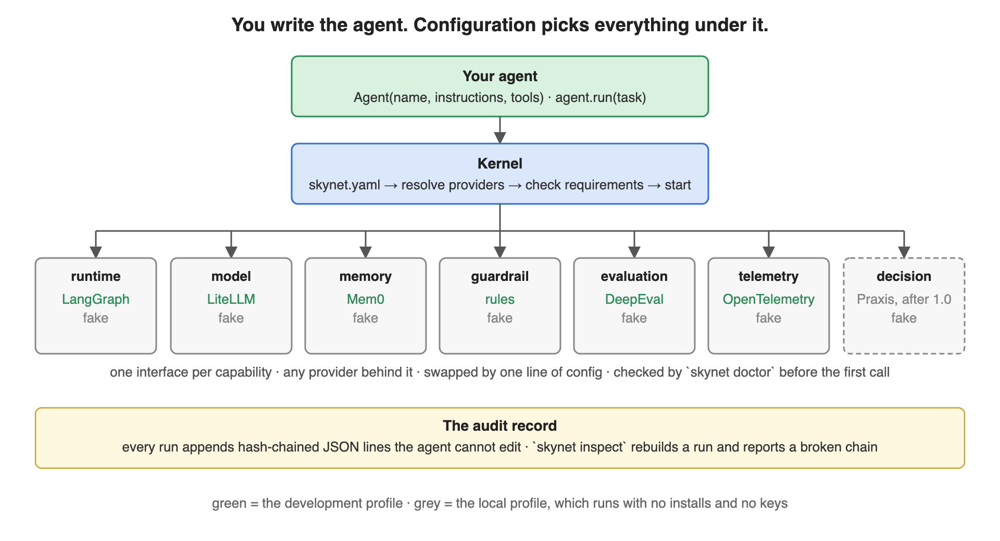
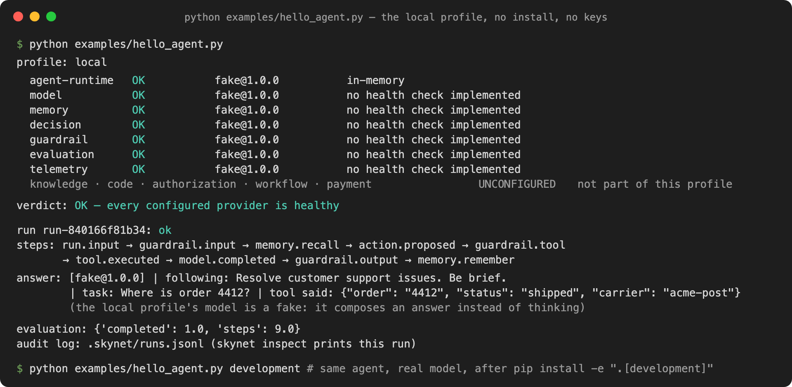
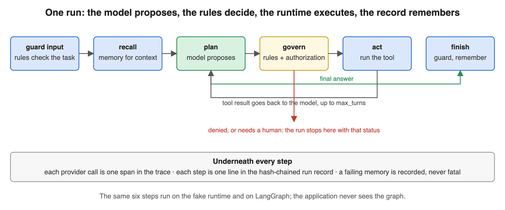

# Skynet+

[](https://github.com/arupmmi07/skynet-plus/actions/workflows/tests.yml)
[](https://www.python.org/downloads/)
[](LICENSE)

*Build agents, not agent infrastructure.*

**Skynet+ is a small Python SDK for building AI agents.** You write the agent: what it
should do and which tools it may use. Skynet+ supplies everything else an agent needs to
run: the loop that runs it, the model, memory, safety rules, scoring, tracing, and a log
of what happened. Each of those is a plug-in you choose in one config file, and you can
swap any of them by changing one line.



## The problem it solves

Every agent project builds the same six things around the model, again and again:

1. a loop that runs the agent step by step,
2. a way to call a model,
3. memory across runs,
4. safety checks on what the agent does,
5. a way to score the results,
6. a log of what happened.

Teams write these from scratch, usually tied to one vendor. Skynet+ gives you all six,
already connected, with good open-source tools behind each one. You keep your code
focused on the actual job.

## Two words you need

- **Provider** — the plug-in that does one job, for example "LiteLLM is the model
  provider". Every job has a fixed interface, so providers are interchangeable.
- **Profile** — a named set of providers. `local` uses in-memory fakes, so it runs with
  no install and no keys. `development` uses real tools: LangGraph, LiteLLM, Mem0,
  OpenTelemetry, DeepEval.

## See it work in sixty seconds

No install, no keys. The fake model does not think; it composes an answer from the
instructions, the task and the tool result. Everything else is real: the loop, the
safety rules, the scoring, the log.

```bash
git clone https://github.com/arupmmi07/skynet-plus.git
cd skynet-plus
python examples/hello_agent.py
```



## Use it in your own project, five steps

**1. Install the real stack** (a virtual environment with Python 3.11 or newer):

```bash
pip install "skynet-plus[development]"
```

**2. Create the config file** in your project folder:

```bash
skynet init --profile development
```

This writes `skynet.yaml`. Open it; every line is one provider choice:

```yaml
profile: development
agent-runtime: {provider: langgraph}
model:         {provider: litellm, model: gpt-4o-mini}
memory:        {provider: mem0}
guardrail:     {provider: rules}
evaluation:    {provider: deepeval}
telemetry:     {provider: opentelemetry}
```

**3. Check the stack before you write any code:**

```bash
export OPENAI_API_KEY=...     # or point `model:` at any provider LiteLLM supports
skynet doctor
```

`doctor` prints one row per provider. Without a key it says exactly which variable is
missing; with one, every row reads `OK`.

**4. Write the agent.** This is the whole file:

```python
from skynet_plus import Agent, tool

@tool
def lookup_order(input: str) -> dict:
    """Find an order by the number in the request."""
    return {"order": "4412", "status": "shipped"}

agent = Agent(name="support-agent",
              instructions="Resolve customer support issues. Be brief.",
              tools=[lookup_order])

result = agent.run_sync("Where is order 4412?")
print(result.output)
```

**5. Look at what happened:**

```bash
skynet inspect     # the run, step by step, from the tamper-evident log
skynet eval        # scores for the last run
```

To change a provider later, edit one line in `skynet.yaml` and run `skynet doctor`
again. Your agent code does not change.

## What happens on every run



The model only *proposes* the next step. The safety rules *decide* whether it may happen.
The runtime *executes* it and feeds the result back. The loop ends with an answer, with a
refusal, or with a request for a human, and every step is written to a log the agent
cannot edit.

## What you get out of the box

- **Any model.** LiteLLM reaches OpenAI, Anthropic, Azure, Bedrock, Vertex, Ollama,
  vLLM and more.
- **Memory** per agent and per user, through Mem0. If memory fails, the run still
  finishes; the failure is logged.
- **Safety rules** on the input, on every tool call, and on the output. Deny, or
  rewrite in place.
- **Scores** for each run through DeepEval.
- **A trace** per run through OpenTelemetry: one span per provider call and per tool.
- **A log you can trust.** Each line carries the hash of the line before it. If anyone
  edits or deletes a line, `skynet inspect` says where.
- **A doctor** that checks everything before the first call and names the fix.

## What it is not

Not another agent framework; it uses LangGraph and the others underneath. Not a tool for
Claude Code or Codex. Not a model.

## Status

Version 1.0.0. 110 tests on Python 3.11 to 3.14, lint and type checks in CI. The next
item on the [roadmap](ROADMAP.md) is a fast-decision layer through
[Praxis](https://github.com/arupmmi07/praxis); everything after that is listed there by ID.

## Read more

| | |
|---|---|
| [How it works](docs/architecture.md) | the shape, one run, the kernel, the log; three diagrams |
| [Writing a provider](docs/providers.md) | add your own model, memory or guardrail |
| [Roadmap](ROADMAP.md) | every planned feature, with status and owner |
| [Architecture pack](docs/architecture/README.md) | the six design documents behind this |
| [Contributing](CONTRIBUTING.md) | how to run the checks |

## Licence

Apache 2.0.
