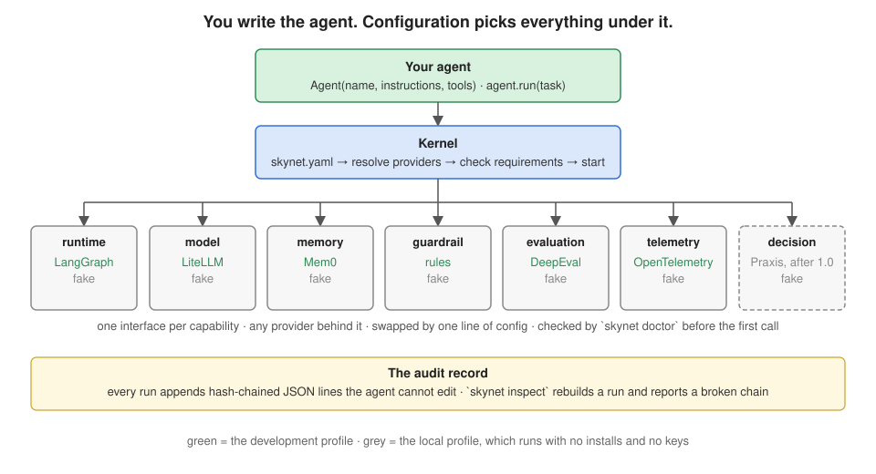
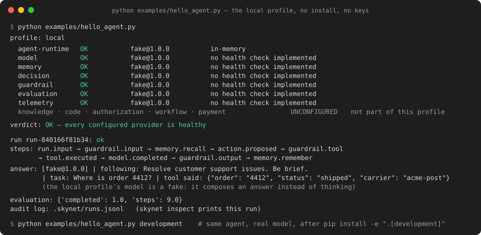

# Skynet+

[](https://github.com/arupmmi07/skynet-plus/actions/workflows/tests.yml)
[](https://www.python.org/downloads/)
[](LICENSE)

*Build agents, not agent infrastructure.*

**A small, provider-pluggable SDK for building AI agents.** You write the agent: its
instructions and its tools. A configuration file picks what runs underneath it — the
agent runtime, the model, memory, guardrails, evaluation and telemetry — and every one of
those can be swapped by changing one line. Before the first call, `skynet doctor` checks
the whole stack and names exactly what is missing. After every run, an audit record the
agent cannot edit says what happened.



## Why

Every agent project rebuilds the same six things around the model: a loop that runs the
agent, a way to call a model, memory, safety checks, a way to score results, and a log of
what happened. Teams build them again each time, badly, and welded to one vendor. Skynet+
is those six things, wired together behind stable interfaces, with the best open-source
implementations adopted as adapters rather than reinvented. The application owns the
domain; Skynet+ owns the infrastructure needed to run it reliably.

## The whole developer experience

```python
from skynet_plus import Agent, tool

@tool
def lookup_order(input: str) -> dict:
    """Find an order by the number in the request."""
    ...

agent = Agent(name="support-agent",
              instructions="Resolve customer support issues.",
              tools=[lookup_order])
result = await agent.run("Where is order 4412?")
await agent.close()
```

```yaml
# skynet.yaml — change a line, run `skynet doctor`; the agent's code does not change
profile: development
agent-runtime: {provider: langgraph}
model:         {provider: litellm, model: ${SKYNET_MODEL:gpt-4o-mini}}
memory:        {provider: mem0}
guardrail:     {provider: rules, deny_tools: [wire_money]}
```

## Try it in sixty seconds

No install and no keys. The `local` profile runs every capability on an in-memory fake, so
the loop, the guardrails, the evaluation and the audit record all work; only the model
does not think — it composes an answer from the instructions, the task and the tool result.

```bash
git clone https://github.com/arupmmi07/skynet-plus.git && cd skynet-plus
python examples/hello_agent.py
```



## Then a real model, in five minutes

```bash
uv venv --python 3.12 .venv && source .venv/bin/activate     # or python3.12 -m venv .venv
uv pip install -e ".[development]"                           # LangGraph, LiteLLM, Mem0, OpenTelemetry, DeepEval
export OPENAI_API_KEY=...                                    # or any provider LiteLLM reaches: edit `model:`
skynet init --profile development && skynet doctor
python examples/hello_agent.py development
skynet run "Where is order 4412?" && skynet inspect && skynet eval
```

`skynet doctor` without a key reports two `DEGRADED` rows naming `OPENAI_API_KEY`; with
one, every row is `OK`. Nothing phones home: the adapters opt out of their libraries'
telemetry unless you opt back in.

## What you get

| | |
|---|---|
| **A governed loop** | the model proposes a step; the rules and the authorization service decide; the runtime executes; a denial or a request for a human ends the run with that status |
| **Any model** | LiteLLM reaches OpenAI, Anthropic, Azure, Bedrock, Vertex, Ollama, vLLM and more; structured output and tool calls map to one portable response |
| **Memory that cannot break a run** | Mem0, scoped per agent, user and run; a failing recall or remember is recorded, never fatal |
| **Guardrails on every step** | input, tool call and output; deny, or modify in place; patterns run over nested content as written |
| **Evaluation from the record** | DeepEval metrics over the canonical run record, with `skynet eval` |
| **One trace per run** | an OpenTelemetry span for the run and a child span per provider and tool call |
| **An audit record** | hash-chained JSON lines; `skynet inspect` rebuilds a run and reports a broken chain |
| **A doctor** | the stack is checked before the first call, with the exact fix for each missing row |
| **Conformance** | one call checks any provider class: lifecycle, every declared feature, no foreign types across the interface |

## What it is not

Not another agent framework: it adopts LangGraph and the others behind adapters. Not a
harness for coding agents, and not a tool that Claude Code or Codex call. Not a model.

## Status

**1.0.0.** 109 tests on Python 3.11 to 3.14, with and without the adapters; the adapter
tests run offline by design (LiteLLM's mock mode, a Mem0 stub, an in-memory exporter, a
judge-free metric). Lint and type checks run in CI. The decision capability — fast, typed,
calibrated decisions through [Praxis](https://github.com/arupmmi07/praxis) — is the first
item after 1.0; see the [roadmap](ROADMAP.md) for that and everything else by ID.

## Documentation

| | |
|---|---|
| [How it works](docs/architecture.md) | the shape, one run, the kernel, the audit record — three diagrams |
| [Writing a provider](docs/providers.md) | manifest, interface, registration, the conformance call |
| [Roadmap](ROADMAP.md) | every feature with an ID, status and owner |
| [Architecture pack](docs/architecture/README.md) | the six design documents this implements |
| [Contributing](CONTRIBUTING.md) | running the checks, what a change needs |
| [Changelog](CHANGELOG.md) | |

## Layout

```
skynet_plus/
  core/        contracts · provider manifests · registry · resolver · profiles · config · run record · kernel
  spi/         one interface per capability (twelve)
  providers/   fakes, the rules guardrail, and the langgraph · litellm · mem0 · otel · deepeval adapters
  sdk/         Agent
  conformance.py
  cli.py       skynet init · doctor · providers · run · inspect · eval · swap
docs/          how it works, how to write a provider, design notes, the architecture pack
examples/      hello_agent.py
tests/
```

## Licence

Apache 2.0.
