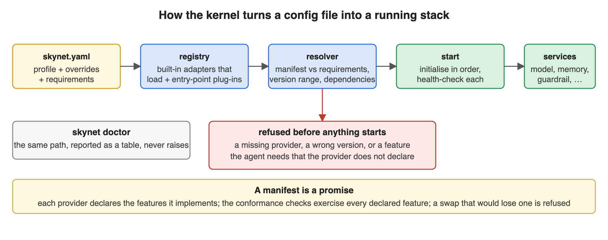
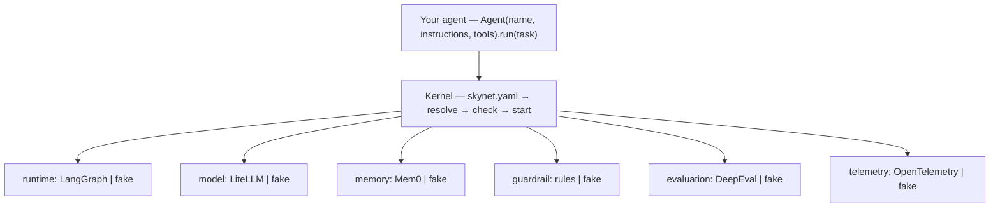
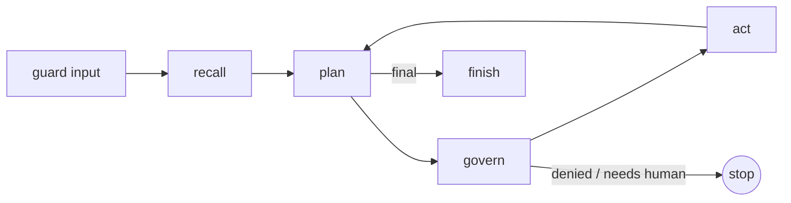
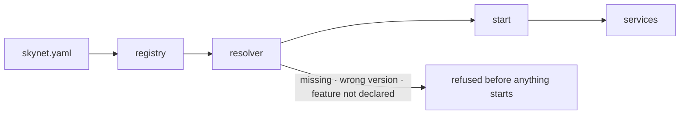

# How Skynet+ works

Three pictures and a page. The long version is the [architecture pack](architecture/README.md)
this implements.

## The shape

An application owns exactly one thing: the agent, its instructions and its tools. Everything
an agent needs to run in production is a *capability* with one interface, and every
capability is served by a *provider* chosen in `skynet.yaml`. Changing a provider is one
line; the application's code does not change, and `skynet doctor` refuses the change
before anything runs if the new provider cannot do what the agent requires.

| Capability | Interface | Providers today |
|---|---|---|
| agent-runtime | runs one task for one agent | LangGraph, fake |
| model | chat completion, structured output, tool calls | LiteLLM (any vendor), fake |
| memory | remember, recall, forget, scoped per agent/user/run | Mem0, fake |
| guardrail | check the input, each tool call, each tool result, and the output: allow, deny, modify | rules, fake |
| evaluation | score a run from its record | DeepEval, fake |
| telemetry | spans and events | OpenTelemetry, fake |
| decision | fast typed decisions with calibrated confidence | fake (Praxis after 1.0) |
| authorization, workflow, knowledge, code, payment | interfaces defined, providers after 1.0 | — |

## One run

The loop is fixed and the application never sees it. The model only *proposes* a step,
as a typed JSON object. The rules and the authorization service *decide* whether that
step may happen. The runtime *executes* it and feeds the result back. The loop stops on a
final answer, on a denial, on a request for a human, or at `max_turns`. The same six steps
run on the in-memory fake runtime and on LangGraph, and a test asserts they are identical.

Memory is auxiliary by design: a failing recall or remember is recorded as a step and the
run still completes with its answer.

## The kernel

A provider ships a *manifest*: its id, version, the capability it serves, the features it
implements, the capabilities it needs started first, and the Skynet+ versions it was
written for. The resolver checks an agent's declared requirements against those manifests
and refuses a stack that cannot satisfy them, before any provider is initialised. Providers
start in dependency order and each is health-checked. `skynet doctor` walks the same path
and prints a table instead of raising, so its verdict is OK exactly when a start would
succeed.

Built-in adapters live inside the package and load only when their library is installed;
providers from other packages register through an entry point and may not replace a
built-in. `skynet_plus.conformance.check_provider` runs the same checks on any provider
class: lifecycle, every declared feature, and that nothing from the underlying library
crosses the interface.

## The audit record

Every run appends JSON lines to `.skynet/runs.jsonl` next to the config file: one line per
step, one header line at the end. Each line carries the hash of the line before it and its
own hash, and a head file beside the log records the last hash and the line count. A
provider receives a handle that can only append. `skynet inspect` rebuilds a run from the
lines as written, so clearing anything in memory changes nothing it shows, and reports an
edited line, a removed line, or a cut tail. Set `SKYNET_LOG_KEY` and the hashes become
HMAC-SHA256, which cannot be recomputed without the key. It is tamper-evident, not signed:
anchoring the head outside the machine is roadmap row SP-044.

## Where to read next

- [Writing a provider](providers.md), with the conformance call to run.
- [The roadmap](../ROADMAP.md): what 1.0 contains and what comes after it, by ID.
- [Design note: the LangGraph runtime](features/SP-022-langgraph-runtime.md).
- [The architecture pack](architecture/README.md): vision, solution, plan, components, design, development.

## Appendix: diagram sources

The images are hand-written SVG in `images/`. Equivalent Mermaid:

